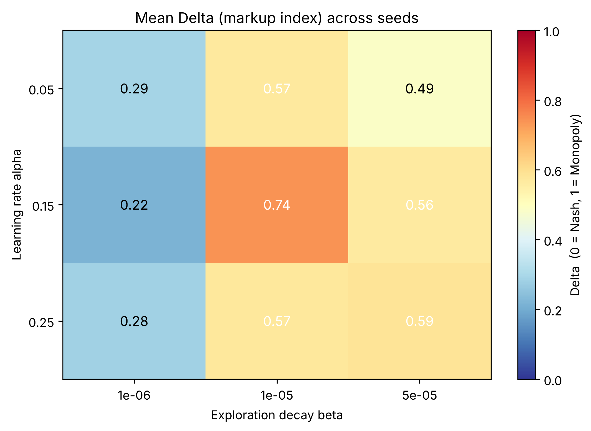
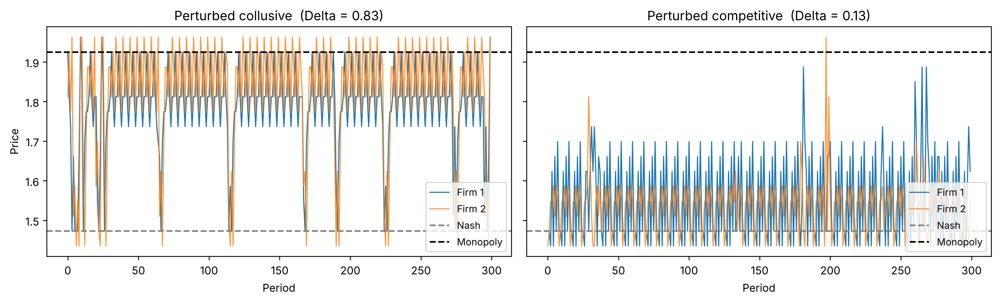

# Learning to collude?

Can you tell from prices alone that pricing algorithms have stopped competing?

Two Q-learning agents set prices against each other in a simulated market. A classifier learns to separate the runs where they end up colluding from the runs where they compete, and is then shown real diesel prices from London petrol stations.

Built as a first-year project at Imperial College London, May to June 2026, and presented as a poster. I built the machine-learning pipeline in this repository; a teammate helped with the economics. The short case study is at [alexlahdiri.com/#collusion](https://alexlahdiri.com/#collusion).

The first two stages are simulation. The third uses real posted prices, and a high score there is not evidence that anyone colluded.

## How it fits together

```
simulator.py         Two Q-learning agents in a repeated Bertrand pricing game with logit demand.
     |               Each run is scored by its markup index: 0 = Nash price, 1 = monopoly price.
     v
classifier.py        Gradient boosting on seven scale-invariant features of a price path.
     |               A run is labelled collusive when its markup index is above 0.5.
     v
fuel_prices.py       Polls 14 UK fuel retailers' published price feeds every six hours.
score_stations.py    Scores each London station, and each pair of stations within 2 km.
```

## What the code shows

The figures and numbers in the first three parts are what this repository prints with its fixed seeds.

### 1. The agents learn to price above the competitive level



Across a 3 × 3 grid of learning rate and exploration decay, three seeds per cell, the mean markup index runs from 0.22 to 0.74. At the peak (α = 0.15, β = 1e-5) the agents settle about three quarters of the way from the Nash price (1.473) to the monopoly price (1.925). Nothing tells them to cooperate.

The experiments cap learning at 500,000 periods so a laptop can finish them in minutes; the model's default is 10 million. With that cap the β = 5e-5 runs converge and most others stop first. The β = 1e-6 column is low because those agents are still exploring when the run ends.

### 2. What collusion looks like in a price path



A converged pair of agents sits on one flat price, which tells a classifier nothing except that they converged. So the training paths come from greedy play with a 2% chance each period of a forced random price. That makes the response visible: after a deviation both prices fall, then climb back to the high price.

### 3. The classifier, and how much of its score is real

48 runs, two firms each, give 96 price paths, 52 of them labelled collusive. The same rows, split three ways:

| How the rows are split | Out-of-fold ROC AUC |
|---|---|
| Rows shuffled | 0.91 (0.95 as a mean of five folds) |
| Whole runs held out | 0.91 |
| Whole parameter settings held out | 0.82 |

The pair classifier, which scores how two price paths move together, gets 0.83 with whole runs held out and 0.62 with whole settings held out.

### 4. Real London diesel prices

The price snapshots are not in this repository, so this part can't be reproduced from here. On the poster: six-hourly snapshots from 24 to 29 May 2026, 109 stations after dropping stale feeds, and 96 pairs of stations within 2 km of each other. 13 of those pairs scored above 0.95, and they were mostly two stations of the same retailer.

That is the expected result of one firm setting prices across its own sites, which is lawful. Two nearby stations passing through the same wholesale cost change would look the same. The classifier finds prices that move together. It cannot say why they do.

## The decision that mattered: not believing 0.95

The first classifier scored a ROC AUC of 0.95. I went looking for the reason and found leakage in the validation. Rows were shuffled freely, so both firms of a run, and other runs from the same parameter setting, sat on both sides of a split.

The validation is now grouped, and `classifier.py` prints the score under each split so the difference is on show. With whole parameter settings held out, the single-series classifier scores 0.82 and the pair classifier 0.62. Those are the numbers I'd quote.

## Limitations

- **The label threshold sits on a grid price.** 14 of the 48 training runs settle exactly on the middle price of the grid, where the markup index equals 0.5 to within rounding error. Their label is decided by which side of 0.5 the rounding falls. `classifier.py` prints a note when this happens.
- **Six parameter settings and 48 runs** is a small training set, and most of those runs stop at the learning cap, not at convergence.
- **The pair classifier transfers poorly** to settings it hasn't seen (0.62), and it is the one applied to the real station pairs.
- **The model is two firms with logit demand.** Real forecourts have brands, supermarkets using fuel as a loss leader, and local market structure.
- **The real data is posted prices**, not transactions, over five days at six-hour intervals.

## Run it

```bash
pip install -r requirements.txt

python simulator.py smoke          # one run, about 15 seconds
python simulator.py sweep          # 27 runs, about 5 minutes: figures/fig1_heatmap.png
python simulator.py trajectories   # 48 runs, about 7 minutes: trajectories_perturbed/
python classifier.py               # trains both classifiers and prints the validation table

python fuel_prices.py --poll       # one price snapshot every six hours
python score_stations.py           # scores stations and pairs once there are a few days of snapshots
```

`fuel_prices.py` reads the JSON files retailers published under the CMA's interim open data scheme. That scheme has since given way to the statutory Fuel Finder service, so some of those addresses may no longer respond.

## Credits

- The model and learning rule follow Calvano, Calzolari, Denicolò and Pastorello (2020), "Artificial Intelligence, Algorithmic Pricing, and Collusion", *American Economic Review* 110(10).
- The `Model` class and the Q-learning loop in `simulator.py` are adapted from [Matteo Courthoud's Python replication](https://github.com/matteocourthoud/Algorithmic-Collusion-Replication) of that paper, used under the MIT licence (see [`NOTICE`](NOTICE)).
